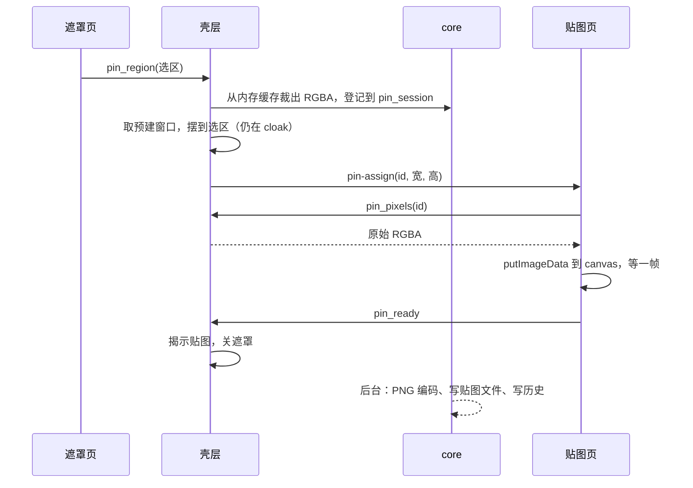

# 贴图位置与卡顿：技术方案

本文基于提交 `c2c2202` 的代码阅读和本机的只读检查写成。没有运行复现，也没有计时数据，文中每一处判断都标了依据。

## 1. 结论

1. **贴图位置不对是 `c2c2202`（预建贴图窗口）引入的。** 读代码能确认两个缺陷，都只在复用预建窗口时出现：
   - 缺陷 A：页面里两次摆放互相打断，贴图留在预建窗口的出生位置，没有移到选区。
   - 缺陷 B：预建窗口向壳层重复报到，下一次贴图会拿到已经贴在屏幕上的那个窗口，旧贴图被换图并移到新选区。
2. **现在跑的是 debug 构建，卡顿感有一部分来自这里。** 进程路径是 `target\debug\shotlet.exe`，页面来自 Vite 开发服务器。
3. **贴图的关键路径上还有 PNG 编码、写盘、读盘、PNG 解码各一次。** 像素本来就在内存里，这四步都可以挪到后台。
4. **F1 的遮罩是先显示窗口、后换成新像素。** 两者之间屏幕上是页面上一次截图的画面。
5. **上一轮的改动没有量过。** `shotlet.log` 里没有一行 `[trace`，说明 `SHOTLET_TRACE` 从没打开过。

顺序：先量基线，再修位置，然后贴图改成内存供图，最后动 F1 遮罩。位置修复可以单独发布。

## 2. 依据

| 事实 | 怎么得到的 |
| --- | --- |
| 运行中的是 `D:\licc\shotlet\target\debug\shotlet.exe` | 查进程路径 |
| 两块屏都是 1920×1080，缩放 100% | 查显示器和 `AppliedDPI`（96） |
| 预建贴图窗口现在在 (78, 78)，136×39，处于 cloak 状态 | 枚举该进程的窗口 |
| `shotlet.log` 只有启动记录，没有 `[trace` | 读日志 |
| 缺陷 A、B 的代码路径 | 读 `src/views/Pin.tsx`、`src/i18n.tsx`、`src-tauri/src/ui.rs` |

两块屏缩放相同，所以本机上的位置问题和 DPI 无关。

## 3. 贴图位置

### 3.1 缺陷 A：两次摆放互相打断

涉及 `src/views/Pin.tsx` 的 `fitPinWindow` 和 `` 的两个回调。

1. `loadImage` 先用一个 `Image` 对象把 blob 解码完，再把同一个地址交给 ``。
2. `` 的 `ref` 回调在提交时发现 `image.complete` 为真，调用一次 `onImageLoad`。随后 `onLoad` 事件再调用一次。
3. 第一次调用把 `placedRef` 置为真，然后等 `setSize`。
4. 第二次调用把 `resizeRequestRef` 加一。第一次调用等完 `setSize` 后发现序号变了，直接返回，`setPosition` 没有执行。
5. 第二次调用因为 `placedRef` 已为真，走的是缩放分支：以窗口当前位置为中心。预建窗口的当前位置是它的出生位置。

结果：贴图出现在出生位置附近（本机现在是 (78, 78)，图片本身在 (100, 100)），不在选区上。

改动前没有这个问题，是因为新建窗口时壳层已经先把窗口摆到选区，第二次调用以正确位置为中心，等于没动。

把握：步骤 2 取决于 `` 提交时是否已经 `complete`。按浏览器对已缓存图片的处理应当成立，但没有实测。

### 3.2 缺陷 B：预建窗口重复报到

1. `Pin.tsx` 的加载 effect 依赖 `[t]`。`src/i18n.tsx` 里 `getSettings()` 一返回就会 `setSettings`，`t` 换成新函数，effect 重跑。开发模式下 `StrictMode` 还会再多跑一次。
2. effect 每跑一次都调用 `pinStandby()`。
3. `ui.rs` 的 `note_pin_standby` 把窗口名追加进一个 `Vec`，不去重。同一个窗口在里面有两份（开发模式三份）。
4. 第一次贴图取走一份。`replenish_pin` 看到列表非空，不补建新窗口。
5. 第二次贴图取到同一个窗口名：`pins[id]` 被覆盖，`pin-assign` 发给已经贴在屏幕上的那个窗口。
6. `reveal_pin` 发现这个窗口名已经在 `pin_revealed` 里，直接返回。遮罩不关，`PinWait` 等满 12 秒后报“贴图没有出现”，前端再退到带标注的路径重贴一次。

结果：连续贴第二张时，第一张贴图换成新图并移到新选区，遮罩卡住约 12 秒。

把握：每一步都能在代码里对上，属于确定的逻辑错误。没有运行复现。

### 3.3 只在缩放不一致时出现的两处

本机不会触发，一并修掉。

- `--pin-glow` 在渲染时按 `window.devicePixelRatio` 算一次。预建窗口先在主屏渲染，再移到另一块缩放不同的屏，边距不会重算。
- `Overlay.tsx` 用 `screen.screenX + selection.x` 算桌面位置。`selection` 是位图像素，`screenX` 是桌面坐标。位图比显示器槽位大时（macOS Retina）两者不能直接相加。

### 3.4 先确认看到的是哪一种

| 操作 | 缺陷 A 的表现 | 缺陷 B 的表现 |
| --- | --- | --- |
| 启动后等几秒，贴第一张 | 贴图出现在主屏左上角附近 | 正常 |
| 不关第一张，换个位置贴第二张 | 同上 | 第一张消失，新图出现在新选区，遮罩卡住约 12 秒 |

终端里的 `pin: reuse <窗口名>` 连续两次出现同一个窗口名，就是缺陷 B。

### 3.5 修法

原则：**窗口的位置和大小只由壳层决定，页面只负责画。** 预建窗口的状态只有一份，放在 core 里。

**(1) 状态机进 core。** 新增 `crates/shotlet-core/src/pin_session.rs`，取代 `ui.rs` 里的 `pin_standby`、`pin_revealed` 两个静态表和 `AppState` 里的 `pins`、`pin_groups`。

```rust
pub enum PinPhase { Warming, Standby, Assigned, Shown }

pub struct PinSlot {
    pub phase: PinPhase,
    pub group: u8,
    pub image: Option<Arc<RgbaImage>>, // 页面取像素用，贴图文件写完后释放
    pub file: Option<PathBuf>,         // 后台写好的 PNG，复制时用
    pub cut: Option<PinCut>,           // 选区在桌面上的 x、y、宽、高
}

pub fn warm(state: &AppState, label: &str);                  // 建窗口时登记
pub fn report_standby(state: &AppState, label: &str) -> bool; // 只有 Warming 能变 Standby
pub fn take_standby(state: &AppState) -> Option<String>;      // Standby 变 Assigned
pub fn mark_shown(state: &AppState, label: &str) -> bool;     // 只有第一次返回 true
pub fn forget(state: &AppState, label: &str);                 // 窗口销毁时
pub fn needs_spare(state: &AppState) -> bool;                 // 没有 Warming 也没有 Standby
```

- 重复报到是空操作，同一个窗口不会被取两次。缺陷 B 从结构上消失。
- `lib.rs` 的 `on_window_event` 里对 `pin-` 开头的窗口处理 `Destroyed`，调用 `forget`。现在 `pins` 表只增不减。
- `scripts/architecture.test.mjs` 把 `pin_session::` 加进 `commands.rs` 必须出现的名单。

**(2) 壳层摆放。** `assign_standby` 在主线程先把窗口摆好，再发 `pin-assign`。Windows 上用一次调用同时给位置和大小：

```rust
SetWindowPos(hwnd, Some(HWND_TOPMOST), x - GLOW, y - GLOW, w + 2 * GLOW, h + 2 * GLOW, SWP_NOACTIVATE);
```

摆完读一次 `GetWindowRect`。跨到缩放不同的屏幕时系统会改窗口大小，读到的尺寸不对就再设一次。macOS 保留现在“位置、大小各设两遍”的做法。

**(3) 页面不再摆第一次。** 删掉 `fitPinWindow` 里 `placedRef` 那个分支，以及 `placeRef`、URL 里的 `x`、`y`。缺陷 A 从结构上消失。

**(4) 缩放也交给壳层。** 新增命令 `pin_zoom(scale)`，壳层按原图尺寸算出以当前中心为准的新矩形，一次 `SetWindowPos` 完成。现在每滚一格是四次 IPC，先改大小再改位置，能看到两步。

**(5) effect 不依赖 `t`。** 加载 effect 的依赖改成 `[]`，错误文案通过 ref 读 `t`。

**(6) 边距跟随缩放。** `--pin-glow` 改成状态，监听 `resize` 时按新的 `devicePixelRatio` 重算。

**(7) 位图像素转桌面坐标收到一处。** 在 `capture_session` 里加一个函数，按 `point_width / width` 换算，贴图、录制、滚动截图共用。

**(8) 自动核对。** `reveal_pin` 揭示前读窗口实际矩形，和期望值一起写进 trace。两者不一致时在 stderr 打一行警告。

**止血办法：** `git revert c2c2202` 能立刻让位置恢复正确，代价是每次贴图重新付建窗口的时间。

## 4. 贴图卡

### 4.1 现在的关键路径（无标注）

从点图钉到贴图出现，按代码顺序：

| 步骤 | 位置 | 说明 |
| --- | --- | --- |
| 从内存缓存裁选区 | `library::pin_region` | 内存复制，便宜 |
| PNG 编码 | `encode_png_fast` | 大选区明显；debug 构建下压缩库没有优化，更慢 |
| 写临时文件 | `write_bytes` | 新文件会被安全软件扫描 |
| 发 `pin-assign` | `assign_standby` | |
| 读文件 | `read_image_bytes` | 同步命令，在主线程 |
| PNG 解码 | `loadImage` | 解一次，`` 可能再解一次 |
| 改大小、改位置 | `fitPinWindow` | 两次 IPC 往返 |
| 等上屏 | `revealPin` | 两帧或 48ms |
| 揭示 | `reveal_pin` | |

带标注的路径更长：前面多出 `canvas.toBlob` 的 PNG 编码、逐块拼字符串转 base64、JSON 传输、base64 解码。

### 4.2 目标路径



关键路径上没有编码、解码和磁盘。

### 4.3 改动点

1. **内存供图。** `pin_pixels(id)` 做成 `#[tauri::command(async)]`，返回 `tauri::ipc::Response`，和 `preview_rgba` 同一种做法。
2. **页面用 canvas。** 把 `src/api.ts` 的 `loadFrozen` 拆出通用的 `loadPixels(command, args, width, height)`，遮罩和贴图共用。贴图页不再有 `` 的加载事件。
3. **后台落盘。** PNG 只编码一次，同一份字节写贴图文件和历史。文件写完后释放 `PinSlot.image`。
4. **右键复制。** 新增 `copy_pin(id)`：内存里还有像素就直接复制，否则读文件。不再依赖页面里的路径。
5. **剪贴板贴图。** `pin_clipboard` 拿到的本来就是 RGBA，直接登记，不先写 PNG。
6. **带标注的路径。** 第二步再做：
   - 页面 `renderScene` 之后用 `getImageData` 取 RGBA，通过 `invoke` 的二进制请求体发给 `pin_annotated`，选区位置放在请求头里。壳层用 `tauri::ipc::Request` 读。
   - 标注文档另发一条 `pin_history(id, document)`，不阻塞贴图。
   - 底图不再从页面传，壳层用同一个选区从冻结缓存里裁。
   - `renderPng` 保留给保存、OCR 用。
7. **等待时间。** `PIN_REVEAL_WAIT` 从 12 秒降到 3 秒。超时后直接揭示窗口，不再让遮罩挂着。

代价：每张贴图在文件写完前多占一份 RGBA（1080p 全屏约 8MB）。

## 5. F1 遮罩

### 5.1 现在的问题

1. **先显示后换图。** `present_overlays` 先 `show` 窗口再发 `overlay-show`。页面收到事件后要 `current_capture`、`preview_rgba` 两次往返才有新像素。遮罩关闭时页面没有清状态，这段时间窗口里是上一次的截图、选区和工具栏。
   - 注释写明这样做是因为隐藏的 WebView 会被降速，等画好再显示要多等约一秒。
   - `overlay_pending` 和 `reveal_overlay` 是“画好再显示”那一版留下的。
2. **热路径上的窗口操作。** 每次 F1 对光标屏窗口做两次改位置、两次改大小、一次显示、一次聚焦，都在主线程。
3. **固定睡 60ms。** 上一次遮罩还在屏幕上时，`grab` 先睡 60ms 等它消失。
4. **其他屏幕来得晚。** 其余屏幕等光标屏 `overlay_ready` 或 250ms 才开始抓，这是上一轮为了给首屏让路加的。

### 5.2 做法：遮罩常驻并 cloak

贴图窗口已经在用这个办法：窗口对系统是显示状态，WebView 正常绘制，DWM 不把它合成到屏幕上。只做 Windows，macOS 保持现状。

1. **启动时摆好。** `prepare_overlay` 给每块显示器建一个遮罩，摆到显示器矩形，cloak，`SW_SHOWNOACTIVATE`，并设为鼠标穿透。
2. **F1 时不动窗口。** 只在显示器矩形和上次不同的时候重摆。
3. **画好再揭示。** 页面画完调 `overlay_ready`，壳层取消鼠标穿透、取消 cloak、给光标屏聚焦。300ms 没等到就直接揭示。
4. **关闭时清状态。** 壳层 cloak 窗口并发 `overlay-hide`，页面丢掉旧画布。每块 1080p 屏释放约 8MB。
5. **替换固定睡眠。** 藏旧遮罩改成 cloak 后调一次 `DwmFlush()`，等到下一次合成就抓屏。
6. **少一次往返。** `overlay-show` 的事件里带上这块屏的 `path`、`width`、`height`、`generation`，页面收到就取像素，`current_capture` 并行取。
7. **其他屏幕不再等。** 窗口操作移出热路径后，其余屏幕在同一个工作线程里紧接着抓，哪块先画好先揭示。是否保留 250ms 的让路由计时决定。

`ui.rs` 里用 `is_visible()` 判断遮罩是否在屏幕上的地方都要改，因为窗口会一直是显示状态。涉及 `conceal_overlays`、`note_overlay_hwnds`、`raise_hidden_overlays`、`conceal_visible_overlays`、`show_overlay_labels`。改成壳层自己记一份“已揭示”的集合。

### 5.3 按计时结果再决定的两项

- **像素传输。** `f1: pixels requested` 到 `f1: pixels received` 如果占大头，换 WebView2 的 SharedBuffer。`Cargo.lock` 里已有 `webview2-com 0.39.1`。
- **抓屏。** `capture: grab begin` 到 `capture: grab pixels` 如果占大头（4K 屏才可能），把 GDI 换成 DXGI 桌面复制。

## 6. 计时

现有的 `SHOTLET_TRACE` 保留，补四处：

1. **页面时间戳。** `tracePage` 现在记的是命令到达壳层的时间。改成页面带上 `performance.timeOrigin + performance.now()`。
2. **贴图补点。** 收到 `pin-assign`、像素到达、画完、揭示，以及 3.5 (8) 的期望矩形和实际矩形。
3. **确认 cloak 是否降速。** 贴图页“画完”到 `pin_ready` 如果每次都接近 48ms，说明 cloak 下 `requestAnimationFrame` 不跑，5.2 的第 3 步要换成别的上屏信号。
4. **汇总脚本。** `scripts/trace-summary.mjs` 读日志，按一次 F1 或一次贴图分组，打印相邻阶段的毫秒差。

量的时候用 release 构建：

```powershell
npm run tauri -- build --no-bundle
$env:SHOTLET_TRACE = "1"; .\target\release\shotlet.exe
```

开发构建另外调一下，让日常手感接近发布版。根目录 `Cargo.toml`：

```toml
[profile.dev.package."*"]
opt-level = 3
debug = "line-tables-only"
```

现在只有 `image`、`png`、`flate2`、`xcap`、`shotlet-platform` 开了优化。按 `Cargo.lock` 的版本，PNG 快速压缩用的是 `fdeflate`，不在这个名单里。

## 7. 实施顺序

| 阶段 | 内容 | 主要文件 | 完成标准 |
| --- | --- | --- | --- |
| 0 | 计时补点，release 构建量基线 | `api.ts`、`shotlet-platform/src/lib.rs`、`scripts/trace-summary.mjs`、`Cargo.toml` | 单屏和双屏的 F1、有无标注的贴图各有一组数字 |
| 1 | 修贴图位置：3.5 的 (1) 到 (8) | `pin_session.rs`（新）、`state.rs`、`ui.rs`、`commands.rs`、`lib.rs`、`Pin.tsx`、`lib/pin.ts`、`architecture.test.mjs` | 连续贴 10 张，期望矩形和实际矩形全部一致；旧贴图不动 |
| 2 | 无标注贴图内存供图：4.3 的 1 到 5、7 | `library.rs`、`pin_session.rs`、`commands.rs`、`api.ts`、`Pin.tsx` | 点击到揭示的耗时对比阶段 0 |
| 3 | 带标注贴图走二进制：4.3 的 6 | `Annotator.tsx`、`draw.ts`、`Overlay.tsx`、`commands.rs`、`library.rs` | 同上 |
| 4 | F1 遮罩 cloak：5.2 | `ui.rs`、`commands.rs`、`capture_session.rs`、`Overlay.tsx` | F1 后看不到上一次截图；按键到首屏出图对比阶段 0 |
| 5 | 5.3 的两项 | 视计时而定 | 只在对应阶段占大头时做 |

每个阶段单独提交。阶段 2、3 建在阶段 1 的 `pin_session` 之上；阶段 4 和贴图无关，可以提前或单独做。`ARCHITECTURE.md` 里 F1 和贴图的两段随阶段 1、4 更新。

## 8. 测试

**core 单元测试（`pin_session`）**

- 同一个窗口报到三次，只有一个 Standby。
- 取走之后再取，返回 `None`。
- 已分配的窗口再报到，不回到 Standby。
- `mark_shown` 第二次返回 `false`。
- `forget` 之后像素和文件记录都不在了。

**前端单元测试**

- `lib/pin.ts` 里缩放后的矩形计算（如果换算留在前端）。

**手工回归**

- 贴图：主屏、副屏各贴；连续贴三张；启动后立刻贴（预建窗口还没报到，走新建）；选区宽度小于 92 像素（预建窗口现在最小是 136×39，确认图不被拉伸）。
- 贴图操作：滚轮缩放、Ctrl 加滚轮调透明度、拖动、双击关闭、右键复制、隐藏和显示全部贴图、切换贴图组。
- 快捷键贴剪贴板图片。
- F1：单屏、双屏、连按、Esc 取消、在两块屏之间移动选屏、窗口模式、自动复制模式。
- 遮罩 cloak 之后：任务栏正常、全屏视频不受影响、Alt+Tab 里没有遮罩窗口、没按 F1 时鼠标点击不被拦截。

## 9. 风险与回退

| 风险 | 应对 |
| --- | --- |
| 缺陷 A 的触发条件没有实测 | 阶段 1 的修法不依赖它是否成立；3.4 的操作可以先确认 |
| cloak 下页面不出帧 | 阶段 0 的第 3 项先量；不出帧就用 `SW_SHOWNOACTIVATE` 加屏外位置代替 cloak |
| 常驻的全屏置顶遮罩影响其他程序 | 鼠标穿透加 cloak；加环境变量 `SHOTLET_OVERLAY_CLOAK=0` 退回显示和隐藏的做法 |
| 二进制请求体在某个平台不可用 | 带标注贴图保留现在的 base64 路径作为退路 |
| 贴图多占内存 | 文件写完即释放像素；窗口销毁时 `forget` |

阶段 4 可以单独回退。阶段 2、3 回退时保留阶段 1，位置修复不受影响。

## 10. 这一轮不做

- 贴图在重启后恢复。
- 用原生分层窗口代替 WebView 画贴图。
- 换掉 xcap。
